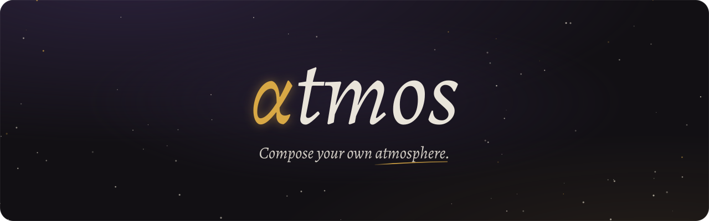
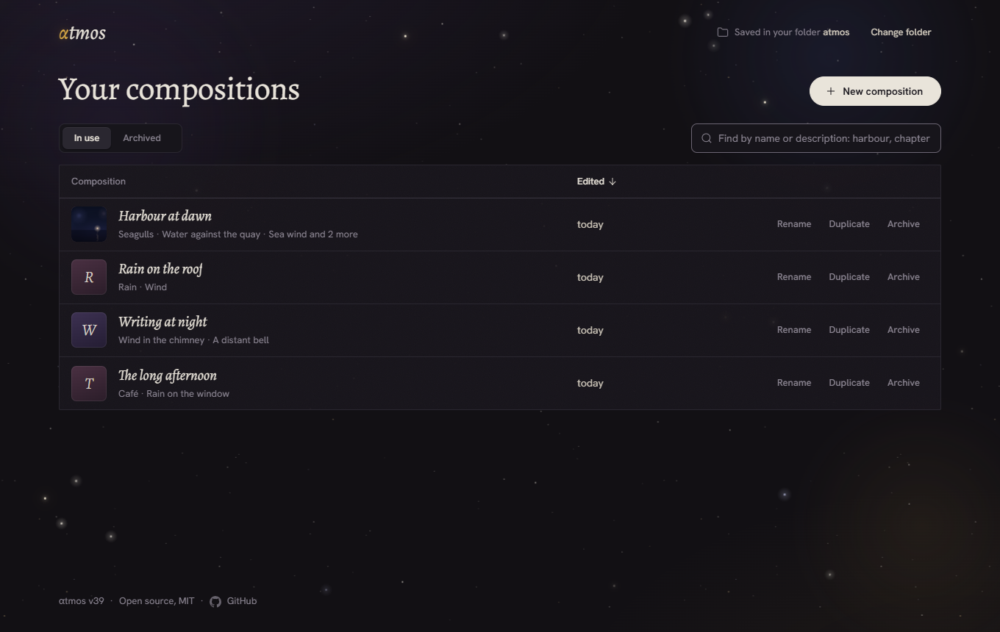
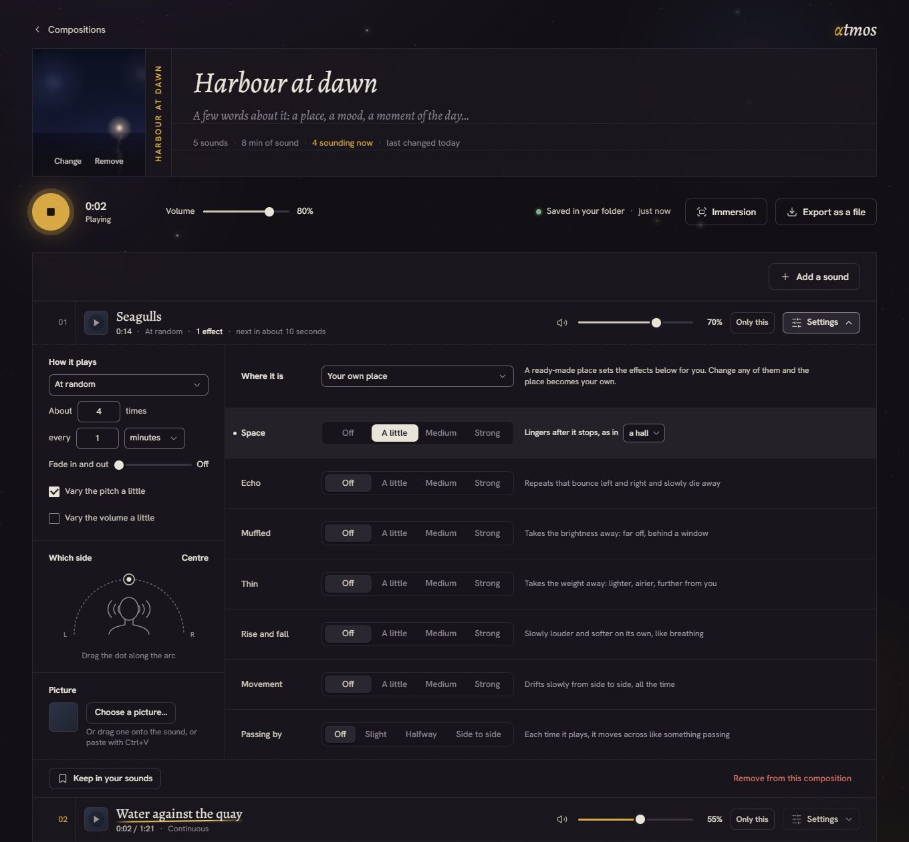

αtmos is for people who write. Build the sound of the place you are writing about: rain against
a window, wind, voices in the next room, a bell far off. Give it a name and a picture, press play,
and leave it on while you write.

Each sound has its own place in the scene. It can be louder or softer, sit to your left or your
right, and play all the time or come back now and then. It can sound as if it were behind a
window, in a cathedral or across a valley.

To see the place as well as hear it, open its picture full-window, with effects over it.

Everything you make is saved into a folder **on your own computer**. Nothing is uploaded, there
is no account, and there is nothing to install unless you want to.

**[Use it →](https://ernestocampese.github.io/atmos/)**





---

## What you need

- **Google Chrome or Microsoft Edge**, on a desktop or laptop computer.
- A folder on that computer where your work will live.

αtmos saves straight into a folder you choose, and only Chrome and Edge let a web page do that.
Firefox and Safari cannot, and neither can phones or tablets. If you open αtmos in one of those,
it will say so rather than half-work.

## First steps

1. Open the link above.
2. Make a new, empty folder somewhere on your computer — for example one called `Atmos` inside
   your **Documents**.
3. Click **Choose a folder** and pick the folder you just made.
4. Your browser will ask whether αtmos may **see and change** files in that folder. Say yes.
   This is the browser protecting you: αtmos can only ever touch the one folder you pointed it at.
5. Click **New composition** and give it a name.
6. Add sounds from **Your sounds**, the panel on the right. A new folder starts empty: drop your
   own audio files into the box at the bottom of that panel, or search for sounds on
   [Freesound](#freesound).

From then on, every change you make is saved by itself about a second later.

You can also **install** αtmos like an ordinary program: in Chrome or Edge, look for the install
icon at the right of the address bar. It then opens in its own window, and works without an
internet connection.

> When you come back, your browser may ask for permission to open the folder again. That is normal
> and deliberate: a web page is never allowed to keep hold of your files silently. Click
> **Reopen** and everything is as you left it.

## Where your work lives

Inside the folder you chose, αtmos keeps:

| Folder | What is in it |
|---|---|
| `sounds/` | your audio files |
| `sounds/freesound/` | sounds fetched from Freesound, with `credits.txt` naming their authors |
| `compositions/` | one small text file per composition |
| `covers/` | cover pictures, and `covers/sounds/` for the picture on each sound |
| `presets/` | sounds you saved with their settings |
| `exports/` | the sound files you export |

You can copy, back up or move this folder like any other. Nothing in αtmos is stored anywhere
else, and nothing is sent anywhere, with one exception: a Freesound search goes to Freesound.

## Managing your compositions

On the list of compositions, each one has a **⋯** button beside its name:

- **Rename** — the name changes in place, and its file follows the new name.
- **Duplicate** — makes a copy you can change freely, leaving the original alone. Useful before
  trying something you are not sure about.
- **Archive** — takes it out of the main list without deleting anything. Archived compositions
  fold away under the list, where each can be **restored** at any time.
- **Delete forever** — removes the composition's file, and its pictures if nothing else uses
  them. It tells you exactly which files go, and it cannot be undone: a web page cannot put
  files in the recycle bin. If you only want it out of the way, archive it instead.

Your sounds are never touched by any of this.

## Sounds and effects

Each sound in a composition has its own volume, its own position between left and right, and its
own way of playing:

- **Continuous** — it loops without stopping. Turn on **Hide the join** and αtmos finds the point
  where the end flows back into the beginning, so there is no seam to hear.
- **At intervals** — it plays every so many seconds.
- **At random** — it plays at unpredictable moments, roughly as often as you ask.

**Settings**, at the end of a sound's line, opens its panel. *Where it is* offers eight ready-made
places, such as *Behind a window*, *In a cathedral*, *Across a valley* or *Under water*. Pick one
and the seven effects under it are set to match; from there you can change any of them, choosing
how much in words: *Off*, *A little*, *Medium*, *Strong*. *No effects*, first in the list, turns
every effect off. The ▶ button on a sound plays that sound on its own, over and over, so you can
hear a change as you make it; **Only this** silences every other sound while the composition plays.

## Freesound

[Freesound](https://freesound.org) is a library of sounds shared by people all over the world.
To search it from inside αtmos you need your own free key — this is done once:

1. Create a free account on freesound.org.
2. Fill in the short form at [freesound.org/apiv2/apply](https://freesound.org/apiv2/apply).
   Any name and description will do.
3. Copy the long code shown under *Client secret/Api key* and paste it into αtmos.

The key is kept in your browser only. It is never sent anywhere except to Freesound.

**Each sound on Freesound carries its own licence.** Some are free to use for anything; others
ask you to credit the author, or forbid commercial use. αtmos records the author and licence of
every sound it fetches in `sounds/freesound/credits.txt`, but respecting those licences is up to
you — particularly if you publish or sell what you make.

## Keyboard

| Key | What it does |
|---|---|
| `Space` | play / stop |
| `Ctrl+S` | save now (αtmos also saves by itself) |
| `Ctrl+Z` | undo removing a sound, while the message is on screen |
| `F2` | on the list, rename the composition that has the keyboard focus |
| `Ctrl+D` | duplicate it |
| `Delete` | archive it · `Shift+Delete` asks to delete it for good |
| `Esc` | close a dialog, an opened tile, or immersion |
| `F` | full screen, in immersion |
| `↑` `↓` | on a sound's drag handle, move it up or down the list |

Everything can be reached with `Tab`.

## For developers

No build step, no dependencies, no framework. Open `index.html` directly, or serve the folder
with any static server:

```
python -m http.server
```

```
npx serve
```

The app is `index.html`, `css/app.css` and the scripts in `js/` (classic scripts, not modules, loaded in order by
`index.html`), with
the fonts and the app icons in `assets/`. `sw.js` and `manifest.webmanifest` make it installable and
usable offline; the service worker registers only over https or on localhost. All paths are
relative, so it also works from a sub-path such as GitHub Pages.

A composition is a JSON file like this:

```json
{
  "version": 2,
  "name": "Harbour at dawn",
  "cover": "covers/harbour-at-dawn.png",
  "masterVolume": 0.8,
  "archived": false,
  "immersion": { "effect": "fog", "background": null, "pixelArt": false, "fill": true },
  "tracks": [
    {
      "file": "sounds/freesound/seagulls-510917.mp3",
      "name": "Seagulls",
      "volume": 0.7, "pan": -0.2,
      "mode": "random", "times": 4, "periodSeconds": 60,
      "crossfade": true, "crossfadeSeconds": 3, "everySeconds": 10,
      "varyPitch": true, "varyVolume": false, "hitFade": 0,
      "filters": { "reverb": 20, "echo": 0, "muffled": 0, "thin": 0, "waves": 0, "movement": 0, "trajectory": 0 },
      "reverbType": "hall", "echoType": "valley",
      "trajectoryDirection": "lr", "trajectoryRandom": false,
      "seamlessLoop": false,
      "image": { "local": "covers/sounds/seagull.png" },
      "muted": false, "solo": false
    }
  ]
}
```

`archived` is optional: a file without it counts as not archived.

## Licence

αtmos is open source under the [MIT licence](LICENSE) — you may use, change and share it freely,
keeping the copyright notice.

The two typefaces it ships, Alegreya and Hanken Grotesk, are under the SIL Open Font License 1.1,
and its interface icons come from [Lucide](https://lucide.dev), under the ISC licence.
See [THIRD-PARTY-NOTICES.md](THIRD-PARTY-NOTICES.md).
